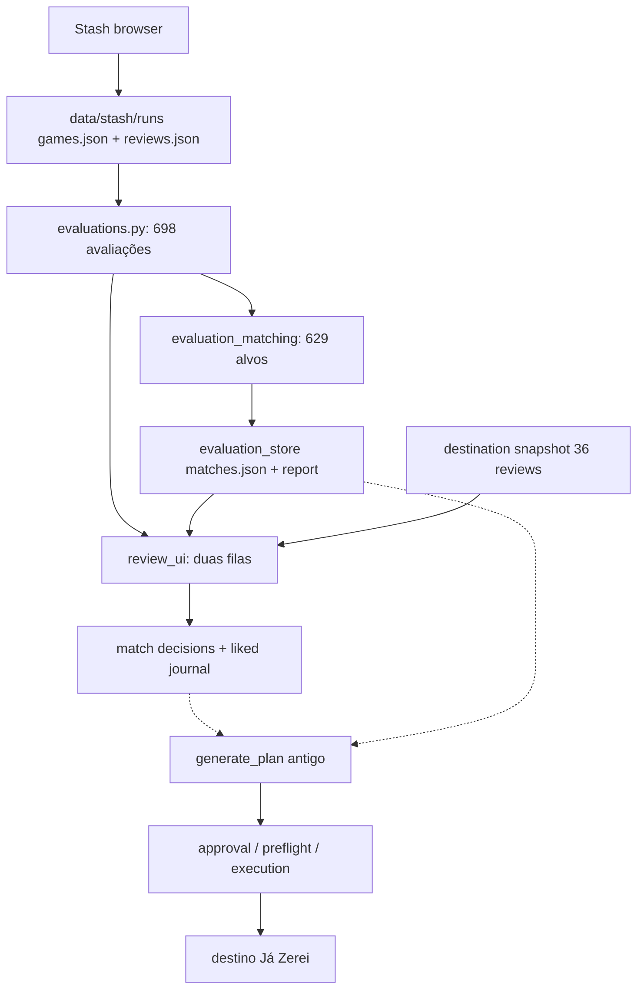

# Avaliação do projeto e opções de reinicialização

> **Complemento operacional:** para retomar o projeto, leia [`docs/project-handoff.md`](project-handoff.md). Este documento explica o diagnóstico e as alternativas; o handoff registra o estado de encerramento e o primeiro marco.

**Data:** 2026-11-26  
**Branch:** `main`  
**Escopo:** consolidação, commits locais e auditoria read-only.  
**Estado de escrita:** gates desligados; nenhuma escrita no Stash ou no Já Zerei nesta etapa.

Este documento é o retrato técnico do projeto no momento da consolidação. Ele separa o que foi comprovado do que é apenas código, teste local ou conhecimento acumulado.

---

## 1. Consolidação Git

Antes da consolidação, o repositório tinha apenas 9 arquivos rastreados. Praticamente toda a implementação estava não rastreada, apesar de existirem coletas, snapshots, planos e uma execução histórica no disco.

### Commits locais criados

| Hash | Commit | Conteúdo |
|---|---|---|
| `6f9e935` | `chore: add project configuration and safe ignore rules` | `.gitignore`, `.env.example`, `pyproject.toml`, requirements, `.gitkeep` |
| `5a93d38` | `feat: add Stash collection and read-only Jazerei clients` | modelos, configuração, storage, transporte, clientes Stash/Já Zerei, navegador |
| `31a33e0` | `feat: add migration planning, approval, preflight and execution core` | matching, normalização, planner, validação, aprovação, preflight, execução, wizard/setup, liked |
| `ad50e4a` | `feat: add evaluation review queues and local review interface` | avaliações, matching de avaliações, elegibilidade, decisões de correspondência, `review_ui`, CLI e web |
| `c02db62` | `test: cover collection, migration, review and write-safety flows` | suíte de testes e fixtures |
| `0c9be02` | `docs: consolidate discovery, safety and execution records` | README e documentação operacional |

O commit deste documento será criado depois dele.

### Dados não versionados

Continuam fora do Git, intencionalmente:

- `data/stash/runs/` — exportações brutas do Stash, com manifestos;
- `data/jazerei/runs/` — snapshots autenticados do destino;
- `data/migration/` — planos, preflights, execuções, decisões, matching, avaliações;
- `data/browser/` — perfil persistente, cookies e sessão local;
- `reports/*.json` — relatórios operacionais;
- `.env`, `.venv`, caches.

Nenhum arquivo de dados, credencial ou perfil de navegador foi adicionado ao Git.

### Correções de segurança feitas antes do commit

- UID real removido de `docs/readiness.md` e de `tests/test_verification_report.py` (substituído por identidade derivada do snapshot).
- Nenhum token, cookie, e-mail ou credencial foi encontrado nos arquivos rastreados.
- `.env` não existe e não foi criado.

---

## 2. Resumo executivo

O projeto tem **conhecimento e dados valiosos**, mas a implementação atual está **estruturalmente pesada e com fontes de verdade concorrentes**.

O que está sólido:

- coleta real do Stash: 1.114 jogos e 76 reviews;
- classificação correta em 76 escritas, 622 somente nota e 416 sem nota;
- busca real no catálogo do Já Zerei;
- matching de 629 alvos com candidatos, scores e estados explícitos;
- snapshots autenticados do destino;
- histórico append-only de decisões;
- 17 reviews efetivamente gravadas e verificadas na execução cancelada;
- interface local de revisão com duas filas;
- suíte de 357 testes, sem falhas.

O que está inconsistente:

- o motor central de elegibilidade não é usado pelo planejamento;
- o planejamento usa caminhos históricos (`matches.json` e `stage9/match-decisions.jsonl`);
- decisões `source-only` de `liked` não são consumidas corretamente pelo planejamento;
- a validação de identidade não compara título/ano/edição;
- `left-4-dead-2` está “elegível” apontando para Left 4 Dead (2008), não Left 4 Dead 2;
- `identity_conflict` não está no motor central;
- “498 prontos para lote” é apenas elegibilidade para aprovar correspondências, não para migrar;
- o painel de plano continua disponível e pode produzir plano com decisões não confiáveis.

**Recomendação principal:** não continuar expandindo a arquitetura atual. Preservar dados, conhecimento, clientes de coleta/leitura, classificação, matching e journals; construir um fluxo linear mínimo para uma ação real, e só depois ampliar. A arquitetura atual deve permanecer como legado consultável, não como base para novas camadas.

---

## 3. Estrutura atual do repositório

```text
stash-jazerei-migration/
├── src/
│   ├── config.py, storage.py, transport.py, cancellation.py, export_run.py
│   ├── stash/            coleta e parsing do Stash
│   ├── browser/          Playwright persistente, política de rede, adaptadores
│   ├── jazerei/          catálogo, reviews, perfil, snapshot, identidade
│   ├── models/           Pydantic: origem, destino, plano, execução, verificação
│   ├── migration/        matching, planejamento, aprovação, preflight, execução
│   ├── review_ui.py      servidor local, serviço de revisão, wizard e estado
│   └── cli.py            comandos operacionais
├── web/                  interface estática da revisão
├── tests/                suíte unitária, integração local e fixtures
├── docs/                 conhecimento de API, arquitetura, segurança e execução
├── data/                 dados operacionais ignorados pelo Git
└── reports/              relatórios operacionais ignorados, exceto .gitkeep
```

### Diretórios de dados

| Diretório | Função | Versionado? |
|---|---|---|
| `data/stash/runs/` | exports brutos e manifestos do Stash | não |
| `data/jazerei/runs/` | snapshots autenticados e manifestos do destino | não |
| `data/migration/evaluations/` | avaliações e matching do run atual | não |
| `data/migration/plans/`, `preflights/`, `executions/` | artefatos do fluxo antigo | não |
| `data/migration/liked-decisions.jsonl` | journal de liked | não |
| `data/migration/stage9/match-decisions.jsonl` | histórico histórico de correspondências | não |
| `data/browser/` | perfil Chromium, cookies, sessão | não |

### Módulos principais

| Área | Arquivos | Responsabilidade | Estado |
|---|---|---|---|
| Configuração | `config.py` | env, gates, identidade esperada, operador | implementado/testado |
| Armazenamento | `storage.py` | JSON, SHA-256, manifestos | implementado/testado |
| HTTP leitura | `transport.py`, `jazerei/client.py` | GET/HEAD e POST allowlisted | implementado/testado |
| Stash | `stash/*` | parsing de jogos/reviews, paginação | real, 1.114/76 |
| Navegador | `browser/*` | Chromium persistente e política read-only | implementado/testado |
| Já Zerei leitura | `jazerei/*` | catálogo, reviews, perfil, snapshot, identidade | parcial/real |
| Modelos | `models/*` | Pydantic de origem, destino, plano, execução | implementado/testado |
| Avaliações | `migration/evaluations.py` | 76/622/416, special editions, proveniência | implementado/testado |
| Matching de avaliações | `evaluation_matching.py`, `evaluation_store.py` | 629 alvos, cache, relatório, run versionado | implementado/real |
| Elegibilidade | `migration/eligibility.py` | regras de migração e lote | implementado, **não ligado ao planner** |
| Correspondência | `match_decisions.py` | journal append-only por run | implementado/testado |
| Liked | `migration/liked.py` | decisões, source-only, reconfirmação, deferimento | implementado/testado |
| Planejamento | `planner.py`, `validator.py` | plano de reviews, validação de liked | implementado/testado; usa caminho antigo |
| Aprovação/preflight/execução | `approval.py`, `preflight.py`, `execution.py`, `executions.py` | cadeia de hashes e execução | implementado/testado; legado complexo |
| Revisão/UI | `review_ui.py`, `wizard.py`, `orchestrator.py`, `setup.py` | estado local, jobs, wizard | implementado/testado; alto acoplamento |
| Web | `web/review.*` | duas filas, filtros, paginação, lote | implementado, testado em headless |
| CLI | `cli.py` | comandos de coleta, matching, plano, execução | implementado/testado |

### Sobreposições e código legado

- `ratification.py` (ratificação antiga de automações) convive com a nova reconfirmação em `liked.py`.
- `eligibility.py` convive com regras espalhadas em `planner.py`, `validator.py` e `generate_plan`.
- `matches.json` histórico convive com `evaluation_store/matches.json`.
- `stage9/match-decisions.jsonl` convive com o novo journal por run.
- `wizard.py`/`orchestrator.py`/`setup.py`/`review_ui.py` repetem estados de operação e seleção.
- `watchlist.py` e `browser/jazerei.py` têm leitura de watchlist que não é chamada por nenhum fluxo atual; o parâmetro `p_user_id` não foi validado contra o contrato real.
- `importer.py` é um resumo de bloqueio, não um importador.
- `verifier.py` e partes de `review_ui`/`wizard` repetem comparação de estado.

---

## 4. Objetivo original e escopo atual

### Objetivo original

Transferir os dados pessoais do Stash para o Já Zerei sem cadastrar jogo por jogo, preservando avaliações e informações relevantes.

### Escopo aprovado atualmente

Migração de **avaliações**:

- 76 avaliações escritas;
- 622 avaliações somente com nota;
- 698 avaliações com nota válida;
- 416 jogos sem nota descartados.

Fora do escopo atual:

- biblioteca pessoal;
- status do Stash;
- Wishlist/Quero Jogar;
- Archived/Dropado;
- Not Played;
- Playing Now;
- favoritos do perfil.

### Limitações conhecidas do destino

- Não existe biblioteca pessoal independente de review.
- “Já joguei” é uma review com nota; não é um estado sem review.
- `liked` é obrigatório e não tem equivalente no Stash; exige decisão humana.
- `platforms` é enviado pelo frontend, mas o contrato do backend não foi confirmado; a origem não tem plataforma.
- Não há data de início/conclusão/abandono, tempo de jogo manual ou tags de jogo no destino.
- Status/progresso/data da review do Stash não são preservados.
- Reviews existentes no destino não são sobrescritas.

---

## 5. Inventário funcional

| Funcionalidade | Implementação | Evidência | Limitações | Confiança |
|---|---|---|---|---|
| Coleta Stash via HTTP | `stash/client.py` | HTTP 403 Cloudflare documentado | não funciona direto | confirmada quebrada |
| Coleta Stash via browser | `browser/stash.py` | 1.114 jogos/76 reviews reais | depende de navegador/perfil | real |
| Paginação Stash | `stash/pagination.py` | 38 páginas de jogos, 13 de reviews | seletores DOM | real |
| Parsing de jogos | `stash/parser.py`, `stash/games.py` | 1.114 registros; testes | campos ausentes | real/testado |
| Parsing de reviews | `stash/reviews.py` | 76 reviews; detalhes | 11 divergências listagem/detalhe | real/testado |
| Classificação 698 | `migration/evaluations.py` | 76/622/416/0 | 110 rating-only especiais | real/testado |
| Catálogo Já Zerei | `jazerei/catalog.py` | busca real; 629 alvos | 1 HTTP 503; 26 sem candidato | real |
| Matching | `matcher.py`, `evaluation_matching.py` | 553 candidatos/49 manuais/26 sem/1 inconclusivo | nenhum aprovado | real/testado |
| Identidade do destino | `jazerei/identity.py`, `state.py` | UID/sessão/API validados | sessão expira | real/testado |
| Snapshot de reviews | `jazerei/state.py`, `snapshots.py` | 36 reviews; manifesto | completo só se paginação provar | real/testado |
| Snapshot de perfil | `profile.py` | RPC real | não usado no escopo | parcial |
| Wishlist leitura | `watchlist.py`, `browser/jazerei.py` | código, sem chamadas | não usada por nenhum fluxo; parâmetro `p_user_id` não validado | **não comprovada** |
| Review upsert | `execution.BrowserWriteTransport` | 17 reviews na execução cancelada; destino 36 | contrato real parcial; `platforms` não enviado | real parcial |
| Delete review | documentado | — | não implementado | não suportado |
| Perfil update | removido | — | não suportado | não suportado |
| Watchlist/favoritos/Playing Now | modelos/plano | — | execução recusa | não suportado |
| `liked` histórico | `liked.py` | 53 eventos | 47 automáticos, 6 humanos, sem operador | real/testado |
| `liked` source-only | `liked.py` | testes | nenhuma decisão real | testado local |
| Reconfirmação automática | `liked.py`, UI | 47 itens | nenhuma confirmada | testado local |
| Deferimento | `liked.py` | teste | nenhum deferimento real | testado local |
| Revisão de correspondência | `review_ui.py`, `web` | headless local | 4 elegíveis inclui L4D2 errado | parcial |
| Lote de correspondência | `/api/match/batch` | 498 elegíveis | não é migração; falhas parciais só em toast | testado local |
| Edição especial | `review_ui`, `match_decisions` | 3 históricos; 123 especiais | confirm não testado ponta a ponta | parcial |
| Elegibilidade | `eligibility.py` | 4/498 | não ligada ao plano; sem título/ano; sem identity_conflict | **inconsistente** |
| Plano antigo | `planner.py`, `approval.py` | 6 planos históricos | usa caminhos históricos | funcional, não confiável |
| Preflight antigo | `preflight.py` | 1 preflight histórico | não usa nova elegibilidade | funcional, fora do escopo |
| Execução antiga | `execution.py` | 1 execução cancelada; 17 verificadas | não retomável | histórica |
| Verificação pós-escrita | `executions.py`, `verifications.py` | código/testes; sem relatório novo | não usada na etapa atual | testada parcial |
| UI de coleta/prepare | `wizard.py`, `review_ui` | testes | muitos estados | testada local |
| UI de execução | `review_ui`, `web` | código | não usar | legado |

---

## 6. Histórico de execução e estado dos dados

### Números

| Item | Quantidade |
|---|---:|
| Jogos no Stash | 1.114 |
| Avaliações com nota | 698 |
| Written review | 76 |
| Rating only | 622 |
| Sem nota | 416 |
| Reviews capturadas no destino (snapshot atual) | 36 |
| Avaliações de origem no destino | 35 |
| Verificadas na execução cancelada | 17 |
| Reconciliadas por conteúdo | 18 |
| Review RE4 fora do escopo | 1 |
| Correspondências históricas aprovadas | 51 |
| Decisões históricas de liked | 53 |
| Automáticas | 47 |
| Humanas | 6 |
| Matching de avaliações | 629 |
| Candidatos | 553 |
| Revisão manual | 49 |
| Sem candidato | 26 |
| Inconclusivo | 1 |
| Edições especiais | 123 |
| Avaliações sem identidade para liked | 23 |
| Elegíveis agora no motor | 4 (3 corretos) |
| Prontos para lote | 498 |
| Conflitos históricos materializados | 0 |

### Explicação das diferenças

- **1.114 → 698:** 416 jogos têm `rating=null` e foram descartados.
- **698 → 76/622:** 76 têm review escrita; 622 têm apenas nota.
- **36 no destino:** o snapshot anterior tinha 19 (18 reviews de origem + RE4) e a execução cancelada acrescentou 17.
- **35 de origem:** 17 verificadas + 18 reconciliadas por conteúdo.
- **1 RE4:** `game_id=974`, sem review correspondente no Stash; preservada e fora do escopo.
- **51 aprovadas:** 17 verificadas na execução + 34 aprovações históricas pendentes. As 18 reconciliações por conteúdo continuam como `candidate`, não como aprovação.
- **53 liked:** 47 automáticos e 6 humanos; todos históricos.
- **629 → 553/49/26/1:** candidatos, manuais, sem candidato e um HTTP 503.
- **4 elegíveis:** 3 corretos e `left-4-dead-2` incorreto.
- **498 lote:** candidatos elegíveis para aprovação de correspondência; não são 498 migrações prontas.

### Execução cancelada

- ID: `20261126T191634Z-execution-stage9-review-20261126T191627Z`.
- Status: `cancelled`.
- 17 ações `verified`; 34 `cancelled`.
- Não deve ser retomada: o plano é histórico, há decisões/identidade pendentes e o novo fluxo não consome seu estado.
- As 17 reviews gravadas são evidência real; as 34 restantes não foram enviadas.

### O que é confiável

- Exports Stash e manifestos.
- 698 avaliações classificadas.
- 36 reviews do snapshot atual.
- 53 eventos de liked.
- Histórico de 51 aprovações.
- 629 resultados de matching como **candidatos**, não aprovações.
- 498 batch como **candidatos a aprovação em lote**, não migração.

### O que precisa de reconciliação

- `left-4-dead-2`: identidade errada (122 vs 124).
- `rango--2`, `ratatouille--1`, `spirit-of-the-north-enhanced-edition`: edição especial não confirmada.
- `spirit-of-the-north`: conflito de identidade e presença no destino.
- 47 automáticos de liked: reconfirmação humana.
- 18 candidatos que já estão no destino: presença, mas aprovação formal pendente.
- 7 written sem correspondência.

---

## 7. Arquitetura real e fontes de verdade



O fluxo principal de **revisão** está implementado. O fluxo de **planejamento** ainda é outro:

- `review_ui.generate_plan` usa `eligible_matches` e `eligible_liked`;
- `eligible_matches` recebe a lista combinada de `matches` (histórico + run), mas o histórico passado é apenas `self._history()` (`stage9`); aprovações novas do run ficam invisíveis para a elegibilidade do plano;
- `matching_provenance` usa o `matches.json` histórico, não o `matches.json` do run de avaliações;
- `eligibility.py` não é chamado por `planner`, `validator`, `preflight` ou `generate_plan`;
- decisões source-only (`game_id=null`) são descartadas silenciosamente por `eligible_liked`;
- `eligible_liked` não verifica `LikedStatus.REQUIRES_RECONFIRMATION`; depende da ratificação antiga.

### Fontes de verdade concorrentes

1. `data/stash/runs/.../games.json` e `reviews.json`;
2. `data/migration/evaluations/<run>/evaluations.json`;
3. `data/migration/matches.json` histórico;
4. `data/migration/evaluations/<run>/matches.json`;
5. `data/migration/stage9/match-decisions.jsonl`;
6. `data/migration/evaluations/<run>/match-decisions.jsonl`;
7. `data/migration/liked-decisions.jsonl`;
8. snapshots do destino;
9. planos/manifestos/preflights/execuções.

Isso é complexidade acidental relevante. A mesma pergunta “o que está aprovado?” tem respostas diferentes dependendo do arquivo consultado.

### Problemas da última auditoria

| Problema | Situação atual |
|---|---|
| `evaluate_eligibility` desconectado de planner/preflight/validator | **continua** |
| `generate_plan` usa caminhos históricos | **continua** |
| Source-only não consumido no plano | **continua** |
| Identidade de candidato não validada centralmente | **continua** |
| `identity_conflict` fora do motor | **continua** |
| UI diverge do estado real | **continua** em L4D2 e contadores |
| Complexidade de estados/UI | **continua** |

---

## 8. Testes

### Números atuais

- **357 testes coletados**;
- **347 aprovados**;
- **10 ignorados**;
- **0 falhas**.

### Distribuição principal

`test_execution` 45, `test_verification_report` 42, `test_review_state` 26, `test_write_transport` 26, `test_collect_directed` 22, `test_review_ui` 15, `test_write_surface` 15, `test_prepare_orchestrator` 12, `test_review_decisions` 12, `test_setup_wizard` 12, demais módulos com menos.

### Evidência real vs teste

- **Real:** coleta Stash, snapshot do destino, matching de 629, 17 reviews gravadas/verificadas, decisões históricas, estado atual de 36 reviews.
- **Teste local:** classificação 698, matching com fixtures, review UI, decisões, liked, segurança de escrita.
- **Somente código/documentação:** atualização de perfil, delete review, fluxo remoto de Wishlist, `platforms`.
- **Não comprovado por teste real:** escrita de rating-only (o destino tem uma review RE4 vazia, mas ela não foi criada pelo migrador), plano novo integrado, lote de 498 via UI, confirmação de edição ponta a ponta.

A suíte é extensa, mas boa parte é unitária/mockada. Ela não substitui a prova de um write real dentro do novo fluxo.

### Lacunas de teste

- L4D2 bloqueado por título/ano.
- Plano consumindo histórico novo e source-only.
- `identity_conflict` no motor de elegibilidade.
- Confirmação de edição “não aprova sozinha”.
- Falha parcial de lote exibida por item.
- Um write real de rating-only e leitura posterior.
- Reconciliar 51 aprovações históricas com validação de título/ano.

---

## 9. Complexidade e custo de manutenção

### Tamanho

- `src/review_ui.py`: 3.199 linhas.
- `src/cli.py`: 2.053 linhas.
- `src/migration/wizard.py`: 1.889 linhas.
- `src/migration/execution.py`: 967 linhas.
- `src/migration/orchestrator.py`: 805 linhas.
- `src/migration/approval.py`: 757 linhas.
- `src/jazerei/state.py`: 735 linhas.
- `web/review.js`: 2.228 linhas.
- 62 arquivos Python em `src`, 33 arquivos de teste, 14 documentos.

### Complexidade necessária

- Chromium persistente para contornar Cloudflare no Stash.
- Política read-only e allowlist de POST.
- Snapshots versionados e hashes.
- Identidade do destino.
- Leitura antes da escrita e idempotência.
- Verificação posterior.
- Revisão humana explícita.

### Complexidade acidental

- Dois mecanismos de histórico de correspondência.
- `ratification` antigo + reconfirmação nova.
- Motor de elegibilidade separado do planner.
- Plano/manifesto/aprovação/preflight/execução com muitos estados para uma operação de um POST de review.
- Wizard, preparação orquestrada, jobs e UI de execução no mesmo serviço.
- Caminhos `stage9` fixos e defaults históricos.
- Contadores e estados visuais que não correspondem ao estado real.
- `watchlist`/perfil legados sem uso.
- Duplicação de scripts de verificação.

### Custo para uma migração simples

Fluxo atual: coletar → snapshot → matching → revisar correspondência → decidir liked → gerar plano → aprovar manifesto → preflight → preparar execução → confirmar ação → executar → verificar.

Um fluxo mínimo para a mesma operação: selecionar avaliação → validar identidade → decidir liked → ler destino → escrever uma review → reler e confirmar.

A diferença é de infraestrutura, não de requisito funcional.

---

## 10. Alternativas

### A. Continuar a arquitetura atual

- Preserva 100% do código, testes e UI.
- Corrige P0/P1: L4D2, elegibilidade no planner, source-only, identity_conflict, contadores.
- Mantém 6+ fontes de verdade e o wizard/plan/preflight/execução.
- Esforço estimado: médio-alto; risco de regressão alto.
- Complexidade residual: alta.

**Quando faz sentido:** se o objetivo for manter a interface rica e a cadeia de aprovação por hash como produto de longo prazo.

### B. Simplificar profundamente

- Mantém coletores, modelos, matching e conhecimento.
- Reduz o fluxo a: avaliações → matching → revisão → decisões → plano simples → execução → verificação.
- Remove/encapsula wizard, ratification, plan bundle, preflight e estados redundantes.
- Esforço médio; risco de perder alguma segurança se não portar read-before-write/verify.
- Complexidade residual: média.

**Quando faz sentido:** se a equipe quiser continuar no mesmo repositório e evitar uma reescrita total.

### C. Reiniciar a aplicação mantendo dados e conhecimento

- Novo módulo pequeno, reaproveitando `stash/*`, `browser/*`, `jazerei/*`, `evaluations.py`, `matcher.py`, `evaluation_matching.py` e os dados.
- Interface mínima: uma tabela de 698 avaliações e decisões.
- Um único journal de decisões, um plano JSON, uma execução simples.
- Mantém o código antigo como legado consultável.
- Esforço inicial menor do que desembaraçar o wizard/plano; risco controlado.
- Complexidade residual: baixa.

**Quando faz sentido:** recomendado. A implementação atual nunca completou o escopo de 698; o valor está nos dados, contratos e aprendizados, não na pilha de estados.

### D. Ferramentas independentes

- `collect`, `review`, `execute` separados.
- Reduz acoplamento interno.
- Transfere para o operador a responsabilidade de passar arquivos, versões e confirmações.
- Pode criar duplicação de estado e mais erros humanos.
- Útil como inspiração para C, não como arquitetura final sozinha.

---

## 11. Arquitetura mínima recomendada

```text
data/source/<run>/
  games.json
  reviews.json

data/evaluations/
  evaluations.json        # 698 avaliações normalizadas
  matches.json            # candidatos e evidências
  decisions.jsonl         # correspondência + liked, append-only
  destination.json        # snapshot atual das reviews
  plan.json               # ações propostas
  execution.jsonl         # tentativas, respostas e verificações

src/minimal/
  collect.py              # importa/valida export Stash
  catalog.py              # busca e cache do catálogo
  classify.py             # 76/622/416
  match.py                # matching + evidências
  review.py               # fila e decisões humanas
  destination.py          # snapshot do destino
  eligibility.py          # uma única fonte de regras
  plan.py                 # plano reproduzível
  execute.py              # leitura prévia, POST, leitura posterior
  verify.py               # comparação
```

Princípios:

- arquivos brutos imutáveis;
- um único modelo de avaliação;
- uma única decisão por `source_ref`;
- uma única função de elegibilidade;
- uma única lista de ações;
- leitura do destino antes de qualquer POST;
- gates explícitos;
- verificação por releitura;
- sem plano/preflight separado da execução;
- sem status de UI que não venha da função de elegibilidade.

Componentes atuais a preservar:

- `stash/*`, `browser/*`, `jazerei/*` de leitura;
- `evaluations.py`, `matcher.py`, `evaluation_matching.py`;
- modelos de origem/destino;
- snapshots e manifests;
- `review_ui` como referência de UX, não necessariamente como base;
- dados e documentação.

Componentes a isolar/abandonar:

- wizard/orchestrator/setup como camada de estado;
- approval/preflight/execution atuais como fluxo principal;
- `ratification` antigo;
- `watchlist`/perfil legados sem uso;
- `matches.json` histórico como fonte de decisão;
- defaults `stage9`.

### Transição sem perda

Preservar:

- `data/stash/runs/20261126T183458Z-stash-browser` e manifestos;
- `data/jazerei/runs/20261126T-evaluation-account-snapshot` (36 reviews);
- `data/migration/evaluations/20261126T201952Z-evaluations` (698/629);
- `data/migration/liked-decisions.jsonl` (53);
- `data/migration/stage9/match-decisions.jsonl` (51 aprovações);
- planos/preflights/execuções históricos;
- execução cancelada e 17 verificações.

Importar diretamente:

- jogos/reviews brutos;
- avaliações normalizadas;
- candidatos de matching (sem aprovar);
- snapshot do destino;
- histórico de decisões como evidência.

Reavaliar antes de usar:

- L4D2, Rango, Ratatouille, Spirit;
- 47 automáticos;
- 18 candidatos que já estão no destino;
- source-only liked;
- qualquer decisão sem operador.

Não importar automaticamente decisões históricas duvidosas.

---

## 12. Recomendação final

1. **O projeto está estruturalmente saudável?** Não. Dados e conhecimento são valiosos; a implementação está fragmentada e com fontes de verdade concorrentes.
2. **A arquitetura atual merece preservação integral?** Não. Merece preservação como legado, não como base de novas camadas.
3. **O que funciona hoje?** Coleta Stash, classificação, catálogo, snapshot, matching, revisão local, liked journal, 17 writes históricos e testes.
4. **Componentes valiosos independentemente da arquitetura?** Coletores, parsers, modelos, `evaluations`, `matcher`, `evaluation_matching`, snapshots, políticas de segurança e documentação de API.
5. **O que cria complexidade sem valor?** Wizard/orquestrador, plan bundle/preflight/execução duplicados, ratificação antiga, caminhos `stage9`, múltiplos arquivos de estado e UI que promete mais do que o backend entrega.
6. **Menor caminho para a migração?** Um fluxo linear de uma avaliação por vez, com matching/approved/liked/edição/destino resolvidos, executado após leitura e verificado por releitura.
7. **Continuar, simplificar ou reiniciar?** **Simplificar profundamente com reinício controlado do fluxo de aplicação (C), preservando dados e conhecimento.** Não apagar o código atual; mantê-lo como legado até o novo fluxo provar paridade.
8. **Primeiro marco verificável?** Uma única review real (preferencialmente rating-only) migrada por um fluxo mínimo, com leitura antes, autorização explícita, gate, POST único, releitura e confirmação; sem plano/preflight sobrepostos e sem tocar nas 35 já existentes.

### Roadmap curto

| Etapa | Objetivo | Critério de conclusão |
|---|---|---|
| 0 | Consolidação | commits locais e este documento |
| 1 | Triagem P0 | L4D2 bloqueado; 3 elegíveis reais; plano desabilitado; nenhum write |
| 2 | Prova de uma ação | uma review rating-only escrita com leitura prévia, gate e releitura; 36→37; sem duplicar as 35 |
| 3 | Fluxo mínimo de avaliações | 698 carregadas, 629 candidatos, revisão de correspondência e liked; decisões auditáveis |
| 4 | Lote controlado | 663 pendentes processados em lotes idempotentes, com retomada e verificação |
| 5 | Aposentadoria do legado | novo fluxo cobre o escopo; código antigo permanece apenas como referência |

Dependências: decisões humanas explícitas, autorização de gates, validação do contrato de `platforms` e confirmação das 3 edições.

---

## 13. Conclusão

O projeto não precisa ser apagado. Precisa ser **desacoplado do excesso**.

O valor real está em:

- dados brutos e snapshots;
- classificação 76/622/416;
- catálogo e matching;
- conhecimento da API;
- journals de decisões;
- evidências das 17 escritas e das 18 reconciliações.

O caminho mais curto e confiável é um fluxo linear pequeno, com uma única fonte de elegibilidade e uma prova real de uma ação antes de qualquer nova infraestrutura de revisão.

**Não iniciar plano, preflight, execução ou migração em lote até a etapa 1 estar concluída.**

Esta consolidação não realizou escrita no Stash ou no Já Zerei, não criou plano/preflight/execução, não alterou decisões, não tocou `.env` e não fez push.
